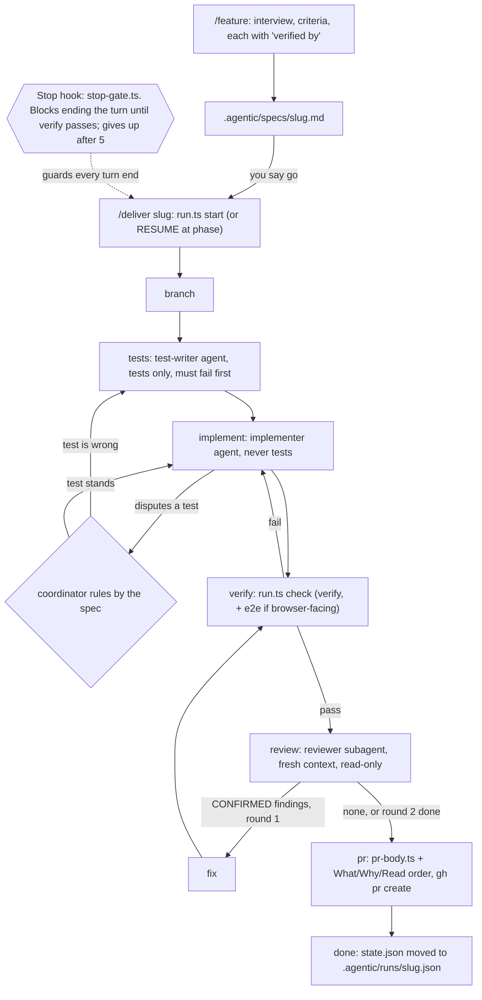

# Agentic workflow: from a planning chat to an open PR

You plan a change with Claude (`/feature`). When you say "go", Claude builds it, checks it, has it reviewed and opens a
PR (`/deliver`) with nobody watching. You review and merge. This page explains how that works, why it is built this
way, and what to do when it goes wrong.

## The mental model

**Harness vs loop.** The *harness* is the program running the model: Claude Code, with its tools, permissions and
hooks. We don't build one. The *loop* is "try, check, fix, check again" until a goal is met. Our loop is made from
pieces Claude Code already has: a skill tells the model the steps, and a hook refuses to let it stop until the
checks pass.

**The verify gate.** A *gate* is a check that must pass before work moves on. Ours is `pnpm verify`: lint, our own
checks in `scripts/`, type checking, tests, build, migration check. It decides "done" by its *exit code* (0 = pass),
never by the model saying "looks good". A loop can only be as trustworthy as its gate: an empty repo with agent files
has nothing to say "no", so the agent would happily loop on broken code. Before trusting a gate, make a deliberate
bad change and watch it fail.

**Maker and checker.** The model that wrote the code is the worst judge of it: it remembers what it *meant*. So the
checking is split across separate *subagents* (fresh model instances with their own tools):
- the **test writer** turns the spec's criteria into failing tests before any code exists, and may change only tests;
- the **implementer** makes them pass and may never change a test. If it thinks a test is wrong, it has to argue
  from the spec, and the main agent (the coordinator, who writes neither) rules on it;
- the **reviewer** reads the finished diff, read-only, and reports findings; only CONFIRMED ones trigger fixes.

No single agent writes both the code and the tests that judge it. The split is enforced twice: a hook in each
agent refuses edits on the wrong side, and `run.ts boundary` checks the actual diff after each agent, which also
catches writes made through the shell. The diff is the guarantee; the hook is the early warning.

**Most effort in code-level checks, least in prose.** Rules written in CLAUDE.md are suggestions the model may forget.
Rules in a type, a lint rule or a script are enforced every time, and their error message teaches the fix at the moment
it matters. So when something goes wrong: first try to make it impossible (types), then detectable (a script), and
only last describe it (one line of prose).

**Backpressure and brakes.** Every loop has a cap: 5 failed stops in a row, 2 review rounds, 2 reviewer retries.
A stuck run stops and says why, instead of burning your usage limit.

**State outside the model.** A run can die at any moment (usage limit, crash, closed laptop). So progress lives on
disk, not in the conversation: `.agentic/state.json` records the phase *before* it starts, and every slice ends with a
`wip:` commit. Re-running `/deliver <slug>` reads the state and continues; every step is safe to repeat.

## The flow

## What each file does

| File | Kind | Job |
|---|---|---|
| `.claude/skills/feature/SKILL.md` | skill (you type `/feature`) | Interview; refuse criteria without a proving test; write the spec; hand off |
| `.claude/skills/deliver/SKILL.md` | skill (`/deliver <slug>`) | The unattended state machine: branch → tests → implement → verify → review → fix → pr → done |
| `.claude/agents/test-writer.md` | subagent | Writes failing tests from the spec; may change only test files |
| `.claude/agents/implementer.md` | subagent | Makes the tests pass; may never change a test; disputes go in its report |
| `.claude/agents/reviewer.md` | subagent | Read-only review in fresh context; one line per finding |
| `.claude/settings.json` | config | Hooks (below) and the permission lists an unattended run needs |
| `scripts/agent/stop-gate.ts` | Stop hook | Runs verify (+ e2e in a run) when the agent tries to finish; exit 2 sends the failure back; cap of 5 |
| `scripts/agent/format-hook.ts` | PostToolUse hook | Biome on each edited file; unfixable problems go straight back to the agent |
| `scripts/agent/run.ts` | CLI | Run state: `start`, `phase`, `handoff`, `boundary`, `check`, `diff`, `review`, `finish` |
| `scripts/agent/role-guard.ts` | agent hook | In each builder agent: refuses an edit on the other side of the test/code line |
| `scripts/agent/files.ts`, `handoff.ts` | library | What counts as a test file; the boundary check on the diff since a handoff |
| `scripts/agent/pr-body.ts` | CLI | PR description from git + state: files, existing tests changed, checks, reviewer findings, the spec |
| `scripts/agent/project.ts` | config | The only project-specific kit file: verify/e2e/format commands, browser paths, migrations folder |
| `scripts/check-applied-migrations.ts` | lint check | Fails when a migration already on main was edited or deleted |
| `.agentic/` (gitignored) | data | `specs/`, `state.json`, `review/`, `runs/<slug>.json` |

Other deterministic checks: Biome's `noFocusedTests` / `noSkippedTests` (an `.only` or `.skip` fails lint; the one
legitimate phone-only skip has a per-file exception in `biome.json`), and `scripts/check-applied-migrations.ts`
(a migration already on main never changes). Existing tests that a run changed or removed are listed in the PR under
"Tests changed or removed", each with the test writer's reason, so you judge them at review.

## The primitives, and when not to use them

| Primitive | What it is for | Don't use it for |
|---|---|---|
| **Hook** (Stop, PostToolUse, UserPromptSubmit) | A program Claude Code runs at a moment. Stop + exit 2 = "you're not done": stderr goes back to the model and it keeps working. | Judgment calls. Hooks should be deterministic and fast enough. |
| **Skill** | A markdown playbook loaded when invoked (`/name`), with arguments. Cheap: only its one-line description sits in context, or nothing with `disable-model-invocation`. | Anything a script can decide. |
| **Subagent** | A fresh model instance with its own tools and model. Isolation (the checker) and keeping noisy work out of the main context. | Work that needs the conversation's history; it starts cold, which costs tokens. |
| **`/goal`** | "Keep working until <condition>", judged after each turn by a small model reading the transcript. | Our "done": it is the model's say-so, not an exit code. A skill also can't start it (not documented). |
| **`/loop`** | Re-run a prompt on an interval in an open session (polling, babysitting). | One-off tasks. |
| **`/schedule` (routines)** | Cloud agents on a cron schedule. | You ruled out schedulers: one human-started conversation is the only trigger. |
| **`claude -p`** | Headless one-shot runs (scripts, CI). The fixture proofs used it. | Unattended work on a Pro plan: it has no "wait for the limit to reset". |

**Hook facts this kit relies on** (Claude Code docs, checked 2026-11):
- Stop hook exit 2 blocks the stop; stderr is given to the model as the reason to continue. Exit 0 stderr is shown
  to nobody, so on give-up the gate prints `{"systemMessage": ...}` to warn *you*.
- `stop_hook_active` is true when the current turn is already a continuation caused by a Stop hook. The old hook
  skipped verify when it was true, which let the *second* attempt through unchecked. The gate ignores it: a retry is
  exactly when the fix needs re-checking. The brakes are our counter (5) and Claude Code's own cap (8 blocks in a row
  without a tool call).
- When a turn ends because of an API error (usage limit included), `StopFailure` fires *instead of* Stop. So a usage
  limit never runs the gate and never counts as a failure.
- Hooks run in Git Bash on Windows if installed, else PowerShell. Our hook commands are `node "${CLAUDE_PROJECT_DIR}/..."`,
  which works in both.

## Running unattended

**Where.** Use the **interactive CLI** (`claude` in Windows Terminal, in the repo) for runs you walk away from. Its
"Continue automatically at usage limit" is documented: on by default for subscription logins since v2.1.234
(`autoContinueAtUsageLimit`, toggle in `/config`). The Desktop app's "Auto-continue when limits reset" checkbox on
the session-limit card exists, but its behavior isn't in the docs yet, so treat it as unproven until you've seen it
work. Not `claude -p`: the wait isn't offered there.

**What happens at the limit:**
- *(a) Mid-turn, main agent*: the CLI shows "Usage limit reached · limit resets 3:45pm", waits in the open session,
  then re-prompts Claude to pick up where it stopped. At most 3 automatic continuations per task, none for a weekly
  limit (resets more than 24h away), and permission prompts still stop it.
- *(b) Inside a subagent*: the subagent ends with an API error; the parent sees "Agent terminated early due to an API
  error" (or partial output with a note). Then the parent's own next request hits the same limit and waits as in (a).
  `/deliver` records the review round as `interrupted` and re-runs it: an interrupted review is never "no findings".
- *(c) While the Stop hook runs*: the hook is a local program and uses no API, so verify finishes. If it blocks, the
  model's next turn hits the limit, see (a). The failure counter only counts verify results.
- *(d) `claude -p`*: the run ends with an error. Re-run `/deliver <slug>`; the state machine resumes.

**What keeps it alive.** The computer must stay awake and the terminal open: closing the lid sleeps the machine and
pauses everything. On Windows set "Sleep: never" while plugged in, or use PowerToys Awake. The Desktop app has its own
keep-awake setting. And everything the run does must be in `.claude/settings.json` `allow`: a permission prompt
stalls the run just like a limit does. In a folder Claude Code hasn't been told to trust (a fresh clone), the
project's `allow` list is ignored: open it interactively once and accept the trust prompt.

**Transcripts.** Sessions are kept as JSONL under `~/.claude/projects/<project>/` (subagent transcripts in
`<session>/subagents/`) and deleted after `cleanupPeriodDays` (default 30) in `~/.claude/settings.json`. Desktop
sessions follow `desktopSessionCleanupPeriodDays`. This machine has both set to 120.

**First time a real usage limit hits during a run, check:** did the CLI show the auto-continue line and resume? Did
it continue the same phase (`node scripts/agent/run.ts status`) without redoing commits? If the reviewer was the one
cut off, is the round recorded `interrupted` and re-run? Did the gate's `stops` stay unchanged? Did a weekly limit
correctly *not* auto-continue?

## Debugging a bad run

1. `node scripts/agent/run.ts status`: phase, slice, review rounds, last verify. Finished runs: `.agentic/runs/<slug>.json`
   (`history` shows every phase entered; a phase listed twice means a resume).
2. Gate gave up? `gate.lastFailure` in the state file holds the last 40 lines. Run `pnpm verify` yourself.
3. Stalled with nothing happening? Almost always a permission prompt, or the machine slept. Check the terminal.
4. The transcript: newest `.jsonl` in `~/.claude/projects/<project>/`. Search for `"is_error":true` to find denied or
   failed tool calls.
5. Reset: delete `.agentic/state.json` (the gate recreates it), or `run.ts finish gave-up "<why>"` to archive it.

## Decisions, and options we rejected

- **Skill + Stop hook, not `/goal`**: `/goal`'s judge reads the transcript; ours is an exit code. A skill can't start a goal anyway.
- **`/deliver`, not `/ship`**: Claude Code has a built-in `/ship`, and a project skill with that name is not loaded.
- **Phase bookkeeping in `run.ts`, not the model editing JSON**: a program writes the state file atomically; the model only calls it.
- **Reviewer gets a diff file, not git**: subagent `tools` can't limit Bash to `git diff`, so the reviewer gets Read/Grep/Glob
  only, and `run.ts diff` writes the diff for it. Sonnet at medium effort: review is reading, not building.
- **Findings as lines, parsed by a program**: a subagent's output is free text. `run.ts review` accepts only the line
  format or an exact `NO FINDINGS`; anything else is `MALFORMED` and is re-run, never a pass.
- **e2e in the gate only during `/deliver`**: it takes minutes; in normal chats the gate runs verify only.
- **Unchanged tree, no re-run**: the gate fingerprints HEAD + uncommitted changes and skips checks already green on it.
- **No `ask` rules on the gates' own files** (`scripts/`, `.claude/`, `biome.json`, `.github/`): tried and removed.
  They prompt you on every legitimate edit to the kit, and they don't cover shell writes (`sed`) anyway. In the
  default permission mode those paths prompt regardless, because they aren't in `allow`. An agent "fixing" a check
  by editing it shows up in the diff, which the reviewer and you read; applied migrations have their own check.
- **Two builder agents instead of a "weakened tests" lint check**: an agent can get around any pattern check (rename
  a test, loosen an assertion). Taking the tests out of the implementer's hands removes the incentive instead.
  Costs roughly 1.5–2x tokens in the build phases, plus a round when the agents disagree.
- **`.agentic/`, not `.workflow/`**: a `.workflow/state.json` makes the global wf-kit guard treat the repo as a wf-kit
  project and block `git push`, which `/deliver` needs.
- **No custom runner, no scheduler, no issue fetching**: one human-started conversation is the trigger.

## When to add more

Not built on purpose. Revisit after ~10 PRs through `/deliver`, or as soon as you catch the same kind of miss twice
in review:
- **(a) Batch retrospective** over `.agentic/runs/*.json` plus transcript digests: which phases fail, how many gate
  blocks per run, where tokens go. Cost: a script plus a few hundred thousand tokens per analysis.
- **(b) UI evidence**: Playwright screenshots or video per acceptance criterion, attached to the PR. Cost: e2e time on
  every run, storage, and a vision-capable review step (tokens).
- **(c) Regression fixtures for the kit**: a fixture spec replayed through `/deliver` after each kit change, asserting
  the gate and phases behave. Cost: a full run's tokens each time the kit changes.

## Tier 2 (documented, not built)

- **Parallel worktrees**: several `/deliver` runs at once, each in its own git worktree. More throughput, but
  `launchpad_test` is one shared database (tests would collide: one DB per worktree needed) and usage burns N times
  faster. Adopt when you're waiting on runs, not on limits.
- **Headless runs** (`claude -p "/deliver slug"`): scriptable, and good for CI or fixtures, but no auto-wait at limits
  and permissions must be complete up front. Adopt for the kit's regression fixtures.
- **Cloud routines**: runs on Anthropic's machines, so no laptop needs to stay awake. They need a cloud environment
  with Postgres for verify, and they are a scheduler, which you ruled out. Adopt if the laptop staying awake becomes the bottleneck.
- **Browser-evidence verification**: see (b) above. Adopt when a UI bug passes the gates.
- **Mutation testing** (e.g. Stryker): changes code on purpose and checks a test fails, which proves "a test that would
  fail without the change" mechanically, where today the reviewer checks it by reading. Slow (minutes to hours) and noisy.
  Adopt, scoped to changed files, if the reviewer keeps missing toothless tests.
- **Self-waiting headless runner**: a script that runs `claude -p`, parses "resets <time>" from the error, sleeps and
  re-runs `/deliver <slug>` (the state machine already makes that safe). Only worth it if CLI auto-continue proves
  unreliable, or for runs longer than its 3 continuations.
