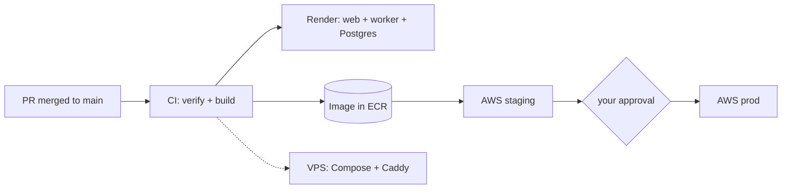
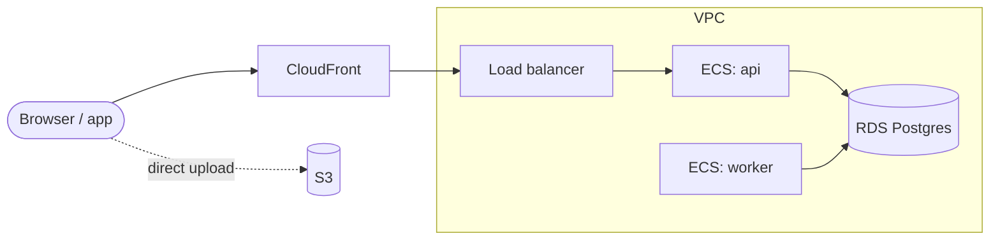
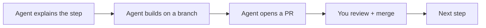

# Roadmap

A production-grade app template, built step by step. An agent builds each step as a small PR; you review it
like you're shadowing a principal engineer.

- **New here?** Read this page, then [setup.md](setup.md).
- **During a phase:** read only that phase's file in [phases/](phases/).
- **[rules.md](rules.md)** is for the agent. Skim it once so you know what to expect.

## Status

| # | Phase | Status |
|---|---|---|
| 0 | [Workspace](phases/00-workspace.md) | done |
| 1 | [Container](phases/01-container.md) | done |
| 2 | [Continuous integration](phases/02-ci.md) | done |
| 3 | [First deploy (Render)](phases/03-render.md) | in progress (3.3) |
| 4 | [Database](phases/04-database.md) | not started |
| 5 | [Observability](phases/05-observability.md) | not started |
| 6 | [AWS foundation](phases/06-aws-foundation.md) | not started |
| 7 | [AWS staging](phases/07-aws-staging.md) | not started |
| 8 | [AWS data + operations](phases/08-aws-data-ops.md) | not started |
| 9 | [AWS production](phases/09-aws-prod.md) | not started |
| 10 | [VPS target (optional)](phases/10-vps.md) | not started |
| 11 | [App foundations](phases/11-app-foundations.md) | not started |
| 12 | [Background jobs](phases/12-jobs.md) | not started |
| 13 | [Email](phases/13-email.md) | not started |
| 14 | [Auth](phases/14-auth.md) | not started |
| 15 | [File storage](phases/15-storage.md) | not started |
| 16 | [Organizations](phases/16-organizations.md) | not started |
| 17 | [Billing](phases/17-billing.md) | not started |
| 18 | [Hardening + scale](phases/18-hardening.md) | not started |
| 19 | [Operations practice](phases/19-operations.md) | not started |
| 20 | [Later: mobile, enterprise](phases/20-later.md) | — |

Follow-ups noticed along the way:
- None open.

## What we're building

A Fastify API and a React SPA in one container image, with Postgres, background jobs, email, auth (web now,
mobile later), organizations, file uploads and Stripe billing. It deploys to Render, AWS or a VPS from the
same Dockerfile.

| Area | Choice |
|---|---|
| Code | TypeScript, Node 24, pnpm workspaces + Turborepo, Biome |
| API / web | Fastify + Zod / Vite + React, TanStack Router + Query, Tailwind + shadcn/ui |
| Data | PostgreSQL 17 + Drizzle; jobs queued in Postgres |
| Auth | Better Auth: sessions in Postgres; cookie on web, `Authorization` header on mobile |
| Services | Resend (email), S3 / R2 (files), Stripe (billing), Sentry (errors), Better Stack (uptime) |
| Delivery | GitHub Actions, PR per change; Terraform for AWS; Cloudflare DNS |

### One image, three platforms

### On AWS

### Every step

One session per phase, model Opus 5.5. To start any phase, open a new session in the repo and send
`Start phase N.`
