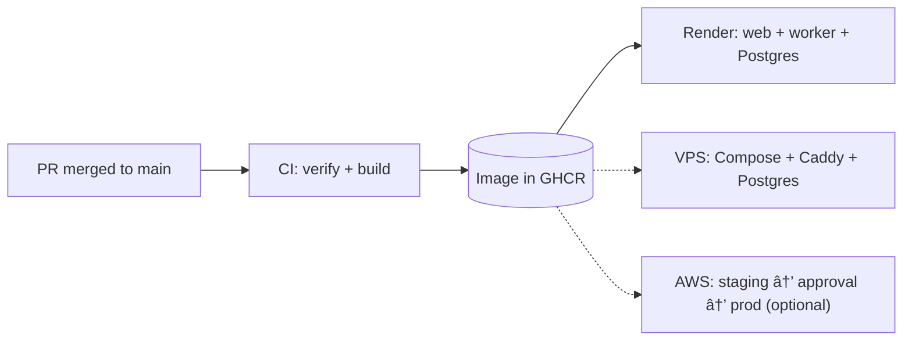
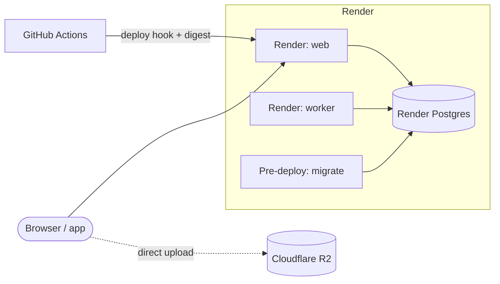
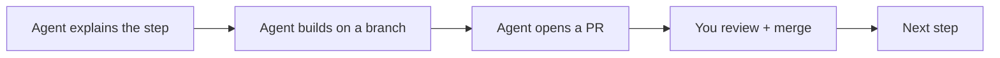

# Roadmap

A production-grade app template, built step by step. An agent builds each step as a small PR; you review it
like you're shadowing a principal engineer.

- **New here?** Read this page, then [setup.md](setup.md).
- **During a phase:** read only that phase's file in [phases/](phases/).
- **[rules.md](rules.md)** is for the agent. Skim it once so you know what to expect.

## Status

| # | Phase | Status |
|---|---|---|
| 0 | [Workspace](phases/00-workspace.md) | done |
| 1 | [Container](phases/01-container.md) | done |
| 2 | [Continuous integration](phases/02-ci.md) | done |
| 3 | [First deploy (Render)](phases/03-render.md) | done |
| 4 | [Render delivery](phases/04-render-delivery.md) | done |
| 5 | [Database](phases/05-database.md) | done |
| 6 | [Observability](phases/06-observability.md) | done |
| 7 | [App foundations](phases/07-app-foundations.md) | done |
| 8 | [Background jobs](phases/08-jobs.md) | done |
| 9 | [Email](phases/09-email.md) | done |
| 10 | [Auth](phases/10-auth.md) | done |
| 11 | [File storage](phases/11-storage.md) | in progress |
| 12 | [Organizations](phases/12-organizations.md) | not started |
| 13 | [Billing](phases/13-billing.md) | not started |
| 14 | [Hardening + scale](phases/14-hardening.md) | not started |
| 15 | [Operations practice](phases/15-operations.md) | not started |
| 16 | [VPS target](phases/16-vps.md) | not started |
| 17 | [AWS foundation (optional)](phases/17-aws-foundation.md) | not started |
| 18 | [AWS staging (optional)](phases/18-aws-staging.md) | not started |
| 19 | [AWS data + operations (optional)](phases/19-aws-data-ops.md) | not started |
| 20 | [AWS production (optional)](phases/20-aws-prod.md) | not started |
| 21 | [Later: mobile, enterprise](phases/21-later.md) | — |

Follow-ups noticed along the way:
- Phase 14 (hardening): a Sentry `tunnel` (browser errors sent via our own `/api` route), so ad blockers
  don't hide them; seen in the 6.4 drill. It would also let the CSP drop its Sentry hosts from `connect-src`
  (7.2). Not done in phase 7: no step named it.
- Phase 14 (hardening): confirm rate limits key on each visitor's real IP (`TRUST_PROXY_HOPS`, 7.2) by hitting
  production from a second network. E2E (7.5) can't check it: one machine, no proxy in front.
- Before launch: replace the placeholder `contactEmail` in `apps/web/src/lib/site.ts` (7.4).
- Next dependency update: Dependabot flags `glob` and `minimatch` (moderate, build-time) via the Sentry and
  `@fastify/static` packages. Bump when they ship patched versions, or add `overrides` like the esbuild one.
- Phase 15 (operations): a runbook to inspect and requeue `failed` jobs (8.2 keeps them; nothing retries them),
  and an alert when jobs fail. `prune-jobs` (8.3) only deletes `done` jobs.
- Phase 15 (operations): the deploy job only starts the worker's deploy (no URL to poll, and a Render API key
  is too powerful to keep in GitHub). A worker heartbeat (its commit in the database, shown by `/api/version`)
  would let the job wait for it too.
- Phase 14 (hardening): `react-email` 6 ships its preview CLI (esbuild, Babel, Tailwind, Prettier...) as runtime
  dependencies: ~67 MB in the image the worker never runs (9.1). Bundling only its components failed: its modules
  aren't marked side-effect free, so tree-shaking keeps the CLI's imports. Revisit if it splits or marks them.
- Phase 15 (rotate secrets): the 5.6 drill rotated the database password after a leak. Learned: a new Render
  credential reaches the app only after a Blueprint **Manual Sync** and a redeploy; check `session_user` (the
  login), not `current_user` (Render's new login acts as the original owner role), before deleting the old one.

## What we're building

A Fastify API and a React SPA in one container image, with Postgres, background jobs, email, auth (web now,
mobile later), organizations, file uploads and Stripe billing. It deploys to Render, a VPS or AWS from the
same image. Each platform is opt-in: the template runs and passes CI with no cloud account.

| Area | Choice |
|---|---|
| Code | TypeScript, Node 24, pnpm workspaces + Turborepo, Biome |
| API / web | Fastify + Zod / Vite + React, TanStack Router + Query, Tailwind + shadcn/ui |
| Data | PostgreSQL 17 + Drizzle; jobs queued in Postgres |
| Auth | Better Auth: sessions in Postgres; cookie on web, `Authorization` header on mobile |
| Services | Resend (email), R2 / S3 (files), Stripe (billing), Sentry (errors + uptime) |
| Hosting | Render (paid): web, worker, Postgres. Later: VPS, then AWS (optional) |
| Delivery | GitHub Actions is the only CI/CD: image to GHCR, deploy by digest; Cloudflare DNS; Terraform for AWS |

### One image, three platforms

### On Render

### Every step

One session per phase, model Opus 5.5. To start any phase, open a new session in the repo and send
`Start phase N.`
